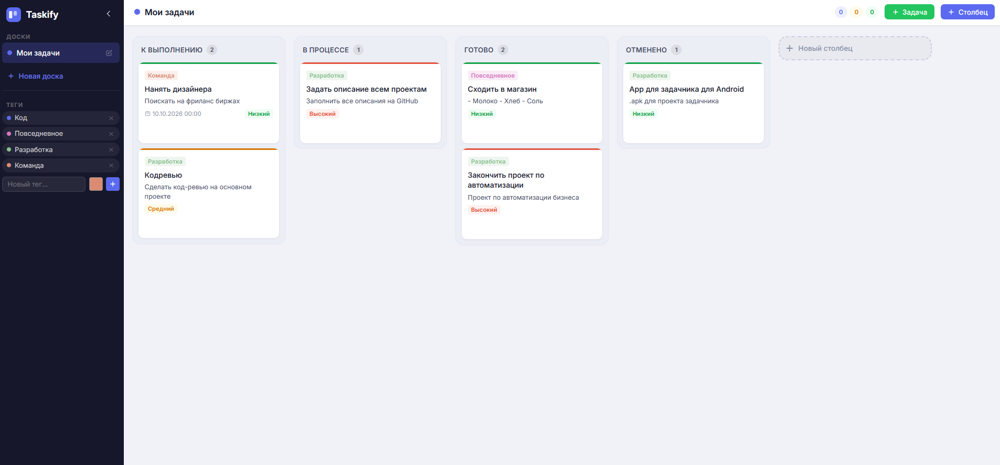
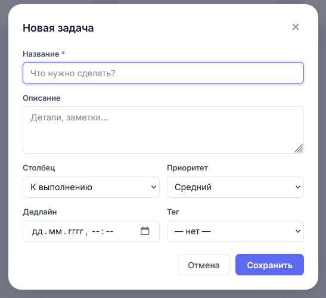
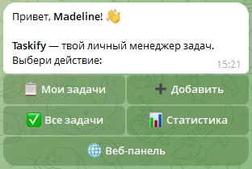
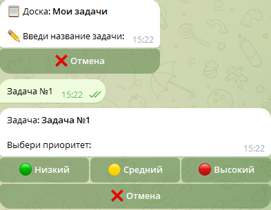
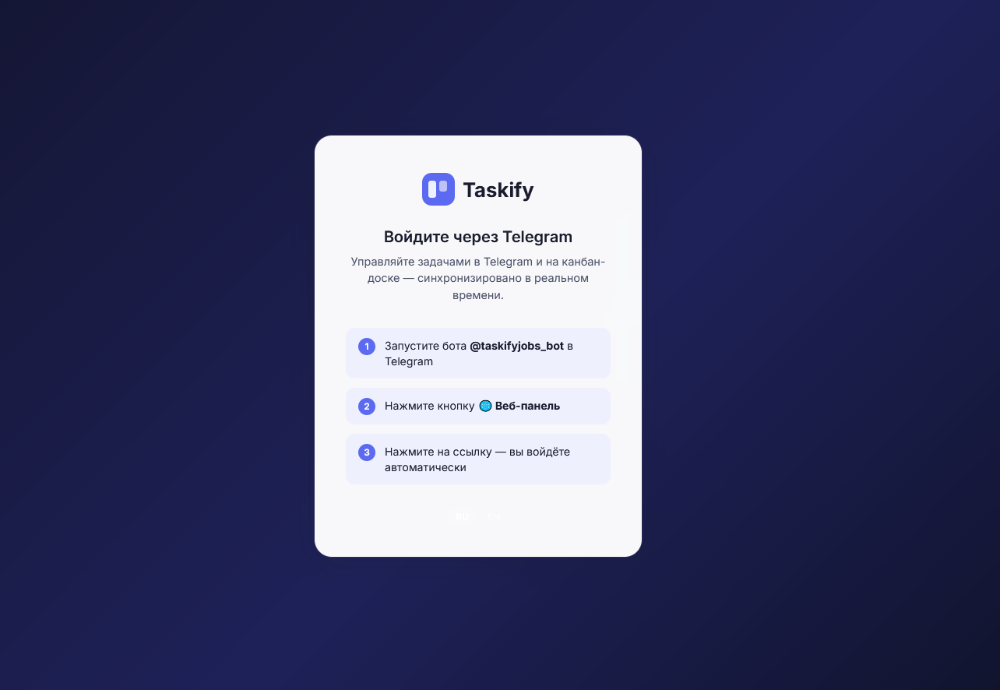

# Taskify

> Open-source task manager with a **Telegram bot** and a **kanban web panel**, synced in real time.


---

## Screenshots

| Kanban Board | Task Modal |
|:---:|:---:|
|  |  |

| Bot Menu | Create Task in Bot |
|:---:|:---:|
|  |  |

| Login Page |
|:---:|
|  |

---

## What is Taskify?

Taskify is a personal task manager that combines a Telegram bot with a web-based kanban board. Create tasks from your phone via Telegram, then organize them on a drag-and-drop board in the browser. Everything stays in sync through a shared SQLite database.

All features are free. No premium tiers, no paywalls.

---

## Features

- **Kanban board** -- drag-and-drop columns and cards in the browser
- **Multiple boards** -- organize projects separately
- **Custom columns** -- add, rename, and delete columns per board
- **Multi-tag system** -- assign multiple color-coded tags to each task
- **Tag filtering** -- click a tag in the sidebar to filter cards across all columns
- **Board sharing** -- public read-only link + invite collaborators by `@username` for full edit access
- **Invite notifications** -- bot sends a message with a direct link when someone is added to a board
- **Priority levels** -- low / medium / high with visual indicators
- **Deadlines** -- set due dates, overdue tasks are highlighted
- **Telegram bot with inline buttons** -- full task management without typing commands
- **Board selection in bot** -- choose which board to add a task to
- **Daily digest** -- morning summary of active tasks (configurable hour)
- **Deadline reminders** -- automatic notifications 24 hours before due date
- **RU/EN interface** -- language toggle on the web panel, bot in Russian
- **Mobile-friendly** -- responsive layout, sidebar collapses on small screens
- **Dev login** -- quick access during development without Telegram

---

## Telegram Bot

The bot uses inline keyboard buttons for navigation. Send `/start` to get the main menu:

| Button | Action |
|---|---|
| My tasks | View active tasks with quick-action buttons |
| Add | Create a task: pick board -> enter title -> priority -> deadline -> tags |
| All tasks | View all tasks grouped by board |
| Stats | Task counts by status |
| Web panel | Get a personal login link |

Text shortcuts still work: `/add`, `/list`, `/stats`, `/web`.

Quick add with pipe syntax: `/add Buy milk | high | 20-04-2026 14:00`

---

## Web Panel

A modern kanban board with a dark sidebar and light content area.

- **Sidebar** -- boards list, shared boards, tags (click to filter), language switch, user info
- **Topbar** -- board name, task counts per board, active tag filter chip, Share / +Task / +Column buttons
- **Board** -- draggable cards across custom columns
- **Multi-tag** -- assign multiple tags per task, shown as colored badges on cards
- **Tag filter** -- click a tag in the sidebar to show only matching cards; topbar chip shows active filter
- **Board sharing**:
  - Share button opens a modal with a toggle for a public read-only link (copy to clipboard)
  - Invite members by `@username` -- they get full edit access
  - Invited users receive a bot notification with a direct link to the board
  - Shared boards appear in the sidebar under "Shared with me"
- **Modals** -- task editor, board editor, column rename, share modal, custom confirm dialogs (no native alerts)
- **Toast notifications** -- non-intrusive feedback for actions

Login flow: start `@taskifyjobs_bot` in Telegram -> press the "Web panel" button -> click the link.

---

## Tech Stack

| Layer | Technology |
|---|---|
| Bot | Python 3.11+, [aiogram 3](https://docs.aiogram.dev/), APScheduler |
| Web | [Flask 3](https://flask.palletsprojects.com/), Jinja2 |
| Database | SQLite (stdlib `sqlite3`) |
| Frontend | Vanilla HTML / CSS / JS, no frameworks |

---

## Project Structure

```
taskify/
├── run_bot.py              # Bot entry point (polling + scheduler)
├── run_web.py              # Web panel entry point (Flask dev server)
├── requirements.txt
├── .env.example            # Environment variables template
├── .gitignore
│
├── database/
│   └── db.py               # Schema, migrations, all CRUD operations
│
├── bot/
│   ├── scheduler.py         # Daily digest + deadline reminders (APScheduler)
│   └── handlers/
│       ├── start.py         # /start command, main menu keyboard
│       └── tasks.py         # All bot logic: FSM, callbacks, commands
│
├── web/
│   ├── app.py               # Flask routes + API endpoints
│   ├── templates/
│   │   ├── login.html       # Login page with instructions
│   │   ├── board.html       # Kanban board (main app)
│   │   └── admin.html       # Admin panel
│   └── static/
│       ├── css/style.css    # Full stylesheet
│       └── js/app.js        # Board logic: modals, drag & drop, API calls
│
└── docs/
    └── screenshots/         # Screenshots for README
```

---

## Quick Start

```bash
git clone https://github.com/Madeline-exe/taskify.git
cd taskify
python -m venv .venv
.venv\Scripts\activate        # Windows
# source .venv/bin/activate   # Linux / macOS
pip install -r requirements.txt
cp .env.example .env          # then edit .env with your BOT_TOKEN
```

Run in two separate terminals:

```bash
python run_bot.py             # Terminal 1: Telegram bot
python run_web.py             # Terminal 2: Web panel at http://localhost:5000
```

See [INSTALL.md](INSTALL.md) for detailed setup instructions and production deployment.

---

## Configuration

All settings are in the `.env` file:

| Variable | Description | Default |
|---|---|---|
| `BOT_TOKEN` | Telegram bot token from [@BotFather](https://t.me/BotFather) | *required* |
| `FLASK_SECRET` | Secret key for Flask sessions | `changeme` |
| `ADMIN_TOKEN` | Password for `/admin?token=...` panel | `admin` |
| `WEB_URL` | Public URL of the web panel | `http://localhost:5000` |
| `FLASK_DEBUG` | Enable dev login at `/dev-login` | `false` |
| `PORT` | Web server port | `5000` |
| `DIGEST_HOUR` | Hour (0-23) for daily digest, Moscow time | `9` |

---

## License

MIT -- free to use, modify, and distribute.

---

## Contributing

Pull requests are welcome. Please open an issue first to discuss what you'd like to change.
